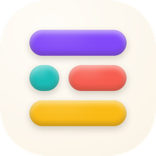
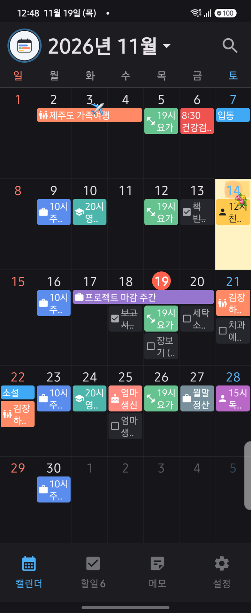
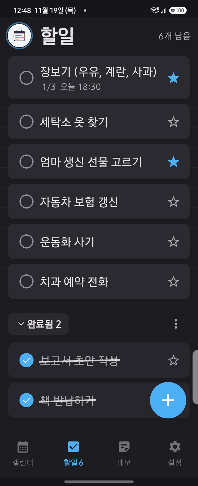
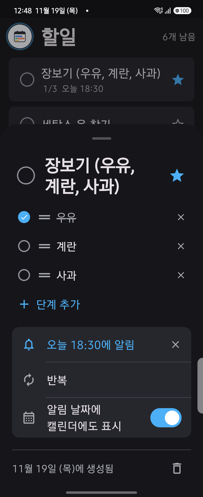
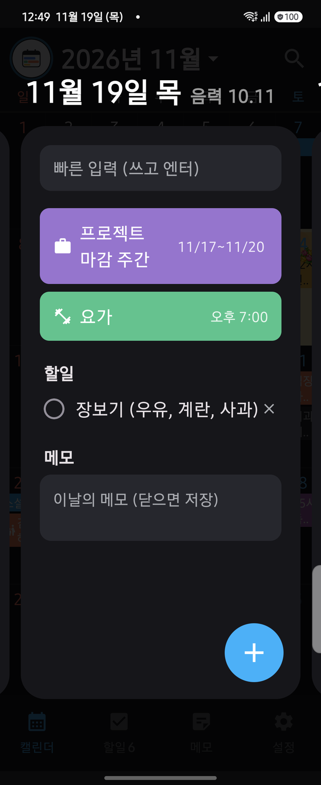

# RiccoBlocks (릭코 블록스)

**블록처럼 쌓아 보는 월간 달력 + 할일 + 메모 앱 (Android)**

광고 없음 · 회원가입 없음 · 인앱결제 없음.
기본 데이터는 내 폰에 저장되고, 기본 기능은 인터넷 없이 동작합니다. Google 연결을 선택하면 본인 Drive를 통해 웹과 동기화할 수 있습니다.

  
  
  

  
  
  

## 다운로드

👉 **[최신 버전 APK 받기 (Releases)](https://github.com/pjh3152/RiccoBlocks-app/releases/latest)**

`Assets` 항목의 `RiccoBlocks-0.1.14.apk` 를 받아 설치하면 됩니다.

- 지원 기기: Android 8.0 (Oreo) 이상
- 처음 설치할 때 "출처를 알 수 없는 앱 설치"를 허용해야 할 수 있습니다.
- 새 버전이 나오면 같은 방법으로 받아 덮어 설치하면 데이터는 그대로 유지됩니다.

☕ 앱이 마음에 드셨다면 [카카오페이로 커피 한 잔 응원하기](https://qr.kakaopay.com/FbUYe4tN3)

## 주요 기능

### 📅 월간 달력
- 일정이 색깔 블록으로 한눈에 보이는 월간 달력, 좌우로 넘겨 달 이동
- 여러 날 일정은 이어진 막대로 표시
- 빈 날짜를 길게 눌러 끌면 기간을 정해 바로 새 일정
- 일정을 길게 눌러 끌어 다른 날로 이동, 양 끝을 끌어 기간 변경
- 복사 · 잘라내기 · 붙여넣기, 모든 변경은 "실행 취소" 가능
- 반복 일정(매일/매주/매월/매년), 알림, 카테고리, 색, 아이콘
- 공휴일 · 대체공휴일 · 24절기 · 음력 날짜 표시, 생일/기념일(음력 지원)
- 날짜 꾸미기: 배경색, 마스킹테이프, 스티커, 배경 그림

### ✅ 할일
- 하단 탭에 남은 할일 개수 표시
- 하위 단계(체크리스트), 중요 표시(★), 미리 알림(24시간 표기), 반복
- 밀어서 완료 / 밀어서 삭제(실행 취소 가능), 끌어서 순서 변경
- 기한이 있는 할일은 달력에도 표시, 달력에서 누르면 상세 화면으로 이동

### 📝 메모
- 일반 메모와 날짜별 메모, 상단 고정, 검색

### 그 밖에
- 홈 화면 위젯: 월간 달력, 오늘 일정
- 삼성 캘린더(기기 캘린더)와 양방향 동기화 (선택)
- 백업/복원: 로컬 ZIP 파일, Google Drive (내 계정)
- 다크 모드, 글자 크기 조절(70~150%)

## 권한 안내

| 권한 | 쓰는 곳 |
|---|---|
| 알림 | 일정 · 할일 알림 |
| 정확한 알람 | 정해진 시각에 알림 울리기 |
| 부팅 완료 수신 | 폰을 다시 켠 뒤 알림 다시 등록 |
| 캘린더 읽기/쓰기 | 기기 캘린더 동기화를 켰을 때만 사용 |
| 인터넷 | Google Drive 백업을 연결했을 때만 사용 |

개인 데이터를 외부 서버로 보내지 않습니다.

## Google Drive 백업

설정 → Google Drive 백업·복원 → **연결** 로 내 Google 계정의 Drive 에 백업할 수 있습니다 (매일/매주 자동 백업 가능).

- 백업은 **내 Drive 안의 이 앱 전용 숨김 폴더**에만 저장되며, 개발자는 볼 수 없습니다.
- 앱은 Drive 의 다른 파일에는 접근하지 않습니다 (`drive.appdata` 권한만 사용).
- 같은 계정으로 연결하면 다른 폰에서도 백업을 골라 복원할 수 있습니다.

## 웹에서 사용하기

**PC에서도 설치 없이 사용할 수 있습니다.**

### [🌐 RiccoBlocks 웹 열기](https://pjh3152.github.io/RiccoBlocks-web/)

- 월간 달력에서 일정 확인·등록·수정, 할 일과 메모 관리
- 날짜 없이 할 일 등록, 새 할 일은 맨 위에 추가, 항목 전체를 마우스로 잡아 드래그하여 순서 변경 (이동 중 카드 표시)
- 앱과 같은 Google 계정으로 연결하면 일정·할 일·메모와 할 일 순서 동기화
- 완료 목록 접기·펼치기, 최근 완료순 표시, 완료 취소, 밀어서 삭제·실행 취소, 완료됨 모두 지우기
- 일정·할일·메모의 추가/편집 화면 구분, 종일 일정은 날짜만 입력
- 마지막 일정 색상·랜덤 모드 기억 (브라우저별 설정)
- Google을 연결하지 않아도 브라우저에 자동 저장, 앱·웹 ZIP 백업 가져오기·내보내기 지원

**연결 방법:** 앱에서 Google 웹·앱 동기화를 켠 뒤, 웹의 **설정 및 백업 → Google 연결하고 동기화**에서 같은 계정으로 로그인하세요. 처음 연결할 때는 앱 ZIP을 먼저 가져올 필요 없이 Google 연결만 하면 됩니다.

**동기화 주기:** 웹은 수정 즉시, 메뉴 이동·창 복귀·인터넷 재연결 때, 그리고 열린 동안 1분마다 동기화를 요청합니다. 저장·전송이 남아 있을 때 닫으려 하면 브라우저 경고가 표시됩니다. 미전송 변경은 브라우저에 보관하고 다시 접속하면 재전송합니다. 앱은 시작·데이터 변경·하단 메뉴 이동 시 동기화하고 백그라운드에서는 15분 주기로 시도합니다. 절전 상태에 따라 지연될 수 있으며, 앱 설정의 ‘지금 동기화’로 바로 요청할 수 있습니다.

종일 일정 알림 설정은 앱에서 제공합니다. 웹에는 알림 예약·반복 규칙 편집·날짜 꾸미기 기능이 아직 없습니다. 브라우저 데이터를 삭제하면 웹의 로컬 자료도 삭제되므로 Google 동기화 또는 ZIP 백업을 이용해 주세요.

## 웹 최신 개선 (2026-11-24)

- 수정·메뉴 이동 즉시 동기화, 전송 중 추가 수정도 이어서 반영
- 미전송 내용 보관과 자동 재시도, 저장·전송 중 닫기 경고
- 완료·완료 취소·삭제 시 앱과 같은 효과음

## 버전 기록

### v0.1.19 (2026-11-24)
- 웹에서 완료한 할일이 폰 동기화 후 미완료로 되돌아갈 수 있던 오류 수정
- 앱·웹 데이터 형식 차이를 실제 수정으로 잘못 인식하지 않도록 개선
- 기존 동기화 연결과 자료 유지

### v0.1.18 (2026-11-24)
- 앱 하단 메뉴를 이동할 때도 Google 동기화 요청 (연속 이동·진행 중 중복 요청 방지)
- 웹 할일 추가 시 제목 자동 포커스
- 웹 ‘완료됨 모두 지우기’ 확인창을 화면 디자인에 맞게 개선

### v0.1.17 (2026-11-24)
- 웹 일정의 알림 설정 누락으로 폰 동기화가 실패하던 오류 수정
- 기존 누락 자료를 수신 시 기본값으로 보완하며 일정·할일 내용과 완료 상태 유지
- 웹의 로그인 대기/미연결 표시 구분, Google 응답 지연 시 무한 대기 방지

이전 버전 보기 (13개)

### v0.1.16 (2026-11-24)
- 앱 신규 할일 입력 문구를 ‘할일 추가’로 통일
- 웹 일정·할일·메모 추가/편집 구분, 새 항목의 삭제 버튼 제거
- 웹 할일 전체 행 드래그와 이동 카드 표시, 새 할일을 맨 위에 등록
- 웹 완료 목록 접기·펼치기, 최근 완료순 표시, 완료 취소·개별 삭제 실행 취소·완료됨 모두 지우기
- 종일 일정은 날짜만 입력하도록 시간 입력칸 정리
- 웹에서도 마지막 일정 색상·랜덤 모드를 기억하고 새로고침 후 유지

### v0.1.15 (2026-11-24)
- 종일 일정의 새 1일 전 미리알림을 오전 10시로 변경 (기존 일정 알림 유지)
- 웹 할 일을 날짜 없이 바로 등록
- 웹 할 일 목록을 마우스로 드래그하여 정렬하고 앱과 순서 동기화

### v0.1.14 (2026-11-23)
- Google Drive를 통한 앱·웹 양방향 동기화 추가
- 설정에 텍스트형 ‘지금 동기화’·‘연결 해제’, 마지막 동기화 상태 표시
- 기존 ZIP 백업·복원과 기존 데이터 유지

### v0.1.11 (2026-11-23)

- 앱 시작 화면의 아이콘을 약 16% 크게 조정했습니다
- 설정의 Google Drive 백업·복원 설명을 ‘내 드라이브에 자동으로 백업·복원’으로 통일했습니다

### v0.1.9 (2026-11-22)

- 앱 아이콘을 새 모양(색 블록)으로 바꿨습니다
- Google 계정을 연결하지 않았을 때 왼쪽 위 동그란 아이콘도 새 앱 아이콘과 같은 그림으로 바꿨습니다

### v0.1.8 (2026-11-20)

- 설정에 **☕ 개발자 응원하기**(카카오페이) 추가
- 앱을 어느 정도 쓴 뒤 가끔(2개월 간격, 최대 6번) 응원 안내가 뜹니다. ‘응원하기’를 누르면 다시 뜨지 않습니다

### v0.1.7 (2026-11-20)

- 할일을 삭제할 때 종이를 구겨 버리는 듯한 짧은 효과음이 나요

### v0.1.6 (2026-11-20)

- 앱 아이콘 배경을 다시 흰색으로 (0.1.4 와 같은 아이콘)

### v0.1.5 (2026-11-20)

- 앱 아이콘 배경을 은은한 하늘색 그라데이션으로 바꿔 홈 화면에서 아이콘이 잘 보이게

### v0.1.4 (2026-11-19)

- 설정의 하위 화면(Google Drive·카테고리 등)에 들어갔다 돌아와도 설정 화면 스크롤 위치가 그대로 유지

### v0.1.3 (2026-11-19)

- 화면 왼쪽 위 동그라미 안의 앱 아이콘이 작게 보이던 문제 수정

### v0.1.2 (2026-11-19)

- 앱 아이콘 변경 (파란 머리 달력 카드)

### v0.1.1 (2026-11-19)

- 첫 공개 버전

## 개인정보처리방침

[개인정보처리방침 보기](https://pjh3152.github.io/RiccoBlocks-app/privacy.html)

## 문의 / 버그 제보

[Issues](https://github.com/pjh3152/RiccoBlocks-app/issues) 에 남겨 주세요.
