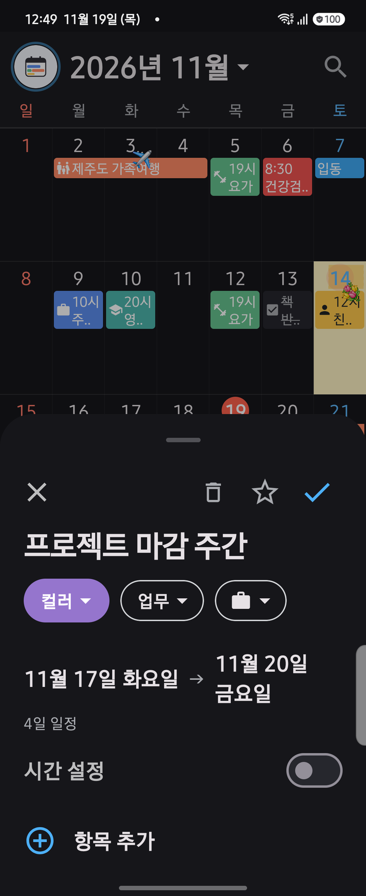
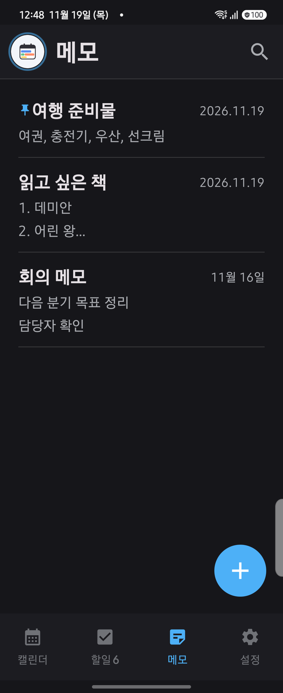

# RiccoBlocks (릭코블록스)

**블록처럼 쌓아 보는 월간 달력 + 할일 + 메모 앱 (Android)**

광고 없음 · 회원가입 없음 · 인앱결제 없음.
모든 데이터는 내 폰 안에만 저장되고, 기본 기능은 인터넷 없이 동작합니다.

  
  
  

  
  
  

## 다운로드

👉 **[최신 버전 APK 받기 (Releases)](https://github.com/pjh3152/RiccoBlocks-release/releases/latest)**

`Assets` 항목의 `RiccoBlocks-x.y.z.apk` 를 받아 설치하면 됩니다.

- 지원 기기: Android 8.0 (Oreo) 이상
- 처음 설치할 때 "출처를 알 수 없는 앱 설치"를 허용해야 할 수 있습니다.
- 새 버전이 나오면 같은 방법으로 받아 덮어 설치하면 데이터는 그대로 유지됩니다.

## 주요 기능

### 📅 월간 달력
- 일정이 색깔 블록으로 한눈에 보이는 월간 달력, 좌우로 넘겨 달 이동
- 여러 날 일정은 이어진 막대로 표시
- 빈 날짜를 길게 눌러 끌면 기간을 정해 바로 새 일정
- 일정을 길게 눌러 끌어 다른 날로 이동, 양 끝을 끌어 기간 변경
- 복사 · 잘라내기 · 붙여넣기, 모든 변경은 "실행 취소" 가능
- 반복 일정(매일/매주/매월/매년), 알림, 카테고리, 색, 아이콘
- 공휴일 · 대체공휴일 · 24절기 · 음력 날짜 표시, 생일/기념일(음력 지원)
- 날짜 꾸미기: 배경색, 마스킹테이프, 스티커, 배경 그림

### ✅ 할일
- 하단 탭에 남은 할일 개수 표시
- 하위 단계(체크리스트), 중요 표시(★), 미리 알림(24시간 표기), 반복
- 밀어서 완료 / 밀어서 삭제(실행 취소 가능), 끌어서 순서 변경
- 기한이 있는 할일은 달력에도 표시, 달력에서 누르면 상세 화면으로 이동

### 📝 메모
- 일반 메모와 날짜별 메모, 상단 고정, 검색

### 그 밖에
- 홈 화면 위젯: 월간 달력, 오늘 일정
- 삼성 캘린더(기기 캘린더)와 양방향 동기화 (선택)
- 로컬 백업/복원 (ZIP 파일)
- 다크 모드, 글자 크기 조절(70~150%)

## 권한 안내

| 권한 | 쓰는 곳 |
|---|---|
| 알림 | 일정 · 할일 알림 |
| 정확한 알람 | 정해진 시각에 알림 울리기 |
| 부팅 완료 수신 | 폰을 다시 켠 뒤 알림 다시 등록 |
| 캘린더 읽기/쓰기 | 기기 캘린더 동기화를 켰을 때만 사용 |
| 인터넷 | Google Drive 백업 기능용 (아래 참고) |

개인 데이터를 외부 서버로 보내지 않습니다.

## 알려진 제한

- **Google Drive 백업**은 현재 개발자 계정에서만 동작합니다. 다른 분들은 설정의 **로컬 백업(ZIP)** 을 사용해 주세요.

## 버전 기록

### v0.1.1 (2026-11-19)
- 첫 공개 버전

## 문의 / 버그 제보

[Issues](https://github.com/pjh3152/RiccoBlocks-release/issues) 에 남겨 주세요.
